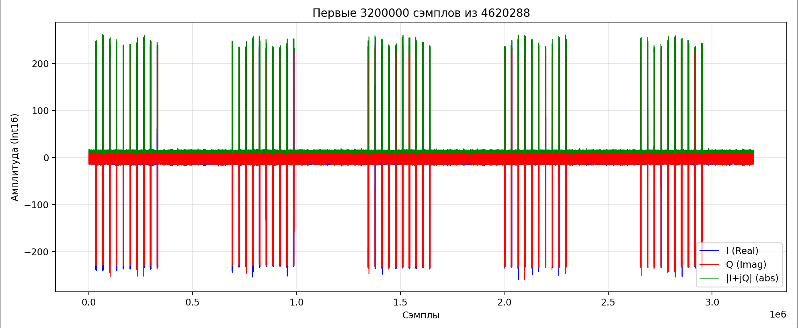
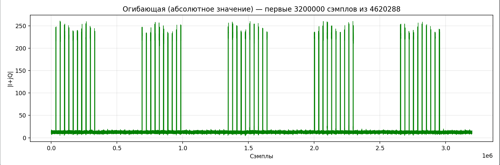

## 🔨 Сборка

### 1. Клонирование

```bash
git clone --recurse-submodules https://github.com/EgeeReyZee/SDR.git
cd SDR
```

> Если папки `libiio`, `SoapySDR` и т.д. оказались пустыми — выполните `git submodule update --init --recursive`.

### 2. Сборка зависимостей

Порядок важен: каждый следующий компонент зависит от предыдущего.

```bash
# 1) libiio
cd libiio && mkdir -p build && cd build
cmake .. -DCMAKE_BUILD_TYPE=Release
make -j$(nproc) && sudo make install && sudo ldconfig
cd ../..

# 2) libad9361-iio
cd libad9361-iio && mkdir -p build && cd build
cmake ..
make -j$(nproc) && sudo make install && sudo ldconfig
cd ../..

# 3) SoapySDR
cd SoapySDR && mkdir -p build && cd build
cmake .. -DCMAKE_BUILD_TYPE=Release
make -j$(nproc) && sudo make install && sudo ldconfig
cd ../..

# 4) SoapyPlutoSDR (плагин для Pluto)
cd SoapyPlutoSDR && mkdir -p build && cd build
cmake ..
make -j$(nproc) && sudo make install && sudo ldconfig
cd ../..
```

### 3. Проверка, что Pluto виден

```bash
iio_info -u ip:192.168.2.1        # низкоуровневая проверка libiio
SoapySDRUtil --find="driver=plutosdr"   # проверка через SoapySDR
```

В выводе второй команды должно появиться устройство с `driver = plutosdr`.

### 4. Сборка приложения

```bash
cmake -S . -B build
cmake --build build -j$(nproc)
```

Готовый бинарник: **`build/main`**.

> ℹ️ В `CMakeLists.txt` по умолчанию включён `CMAKE_BUILD_TYPE=Debug` — это удобно для отладки через `gdb`.

---

## ▶️ Запуск

1. Подключите Pluto по USB и убедитесь, что он отвечает (`ping 192.168.2.1`).
2. Запустите приложение:

```bash
./build/main
```

<!-- TODO: если main принимает аргументы (частота, fs, усиление, имя файла) — опишите их здесь -->

Если SoapySDR не находит устройство, проверьте:

```bash
SoapySDRUtil --info      # виден ли модуль plutosdr в списке
ldconfig -p | grep -i soapy
```

После работы приложение сохраняет IQ-отсчёты в файл — его мы и будем визуализировать.

---

## 📊 Визуализация

Для анализа записи используется скрипт [`src/read.py`](src/read.py).

```bash
python3 src/read.py
```

Примеры:




---

## 🗂 Структура репозитория

```
SDR/
├── libiio/            # транспорт к устройству
├── libad9361-iio/     # управление AD9361/AD9363
├── SoapySDR/          # SDR API
├── SoapyPlutoSDR/     # плагин Pluto для SoapySDR
├── src/
│   ├── main.c         # приложение
│   └── plot_iq.py     # визуализация IQ
├── CMakeLists.txt
└── README.md
```